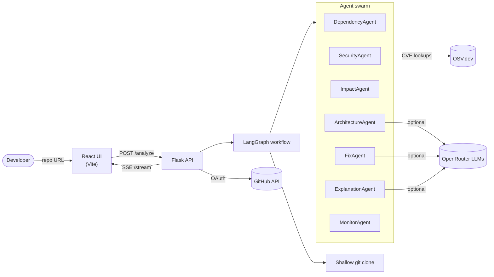

<div align="center">


# Argus

**The all-seeing AI analyst for GitHub repositories.**

Paste a repository URL. Argus clones it, maps its dependencies, draws its architecture, looks for vulnerabilities and known CVEs, measures the blast radius of a change and answers questions about the code. Every step streams live to your browser.

[](https://github.com/Atharvchaskar008/Argus/actions/workflows/ci.yml)
[](LICENSE)
[](CONTRIBUTING.md#nexus-spring-of-code-nsoc26)
[](CONTRIBUTING.md)


[Quick start](#quick-start) · [Deploy](#deploy) · [Contribute](CONTRIBUTING.md) · [Good first issues](https://github.com/Atharvchaskar008/Argus/issues?q=is%3Aissue+is%3Aopen+label%3Alevel1) · [Report a bug](https://github.com/Atharvchaskar008/Argus/issues/new/choose)

</div>

---

## Why Argus?

Opening an unfamiliar codebase is slow. You have to find out how it's structured, which modules everything depends on, what breaks if you touch a file and whether it ships with known vulnerabilities. Argus answers those questions in a couple of minutes by combining **deterministic analysis** (AST parsing, graph algorithms, rule-based scanning, the OSV vulnerability database) with **LLM reasoning** where it adds value. It still works with no API keys at all.

## Features

| | What you get |
|---|---|
| 🕸️ **Dependency graph** | Python files are parsed with `ast` (imports, classes, functions) into a NetworkX graph with centrality metrics. JS/TS files are discovered and listed. |
| 🏛️ **Architecture diagrams** | C4 *System Context*, *Container* and *Component* views plus request-flow diagrams, rendered with Mermaid. LLM-generated, with a heuristic fallback. |
| 🛡️ **Security scanning** | 10 heuristic rules (hard-coded secrets, `eval`/`exec`, `shell=True`, SQL injection, unsafe `pickle`, `innerHTML` XSS, open redirects, debug mode…) plus CVE lookups in [OSV.dev](https://osv.dev) for dependencies in `requirements.txt` and `package.json`. |
| 💥 **Blast-radius analysis** | See which modules are affected downstream when a file changes, and which nodes are most critical. |
| 📊 **Quality and maintainability** | Graded code-quality and maintainability reports with prioritised recommendations. |
| 💬 **Ask the repository** | Chat about architecture, risks and "what should I fix first?", grounded in the analysis results (up to 20,000 characters of context). |
| 🩹 **AI fix suggestions** | Remediation patches for findings, gated behind a human approval step (API). |
| 📡 **Live agent activity** | Seven specialised agents report progress over Server-Sent Events. |
| 🔐 **Private repositories** | Sign in with GitHub (OAuth) to pick and analyse your private repos. |
| 🔌 **REST API** | Everything in the UI, plus repository comparison (`/compare`) and JSON report export (`/export`). See [docs/API_REFERENCE.md](docs/API_REFERENCE.md). |

## How it works



| Agent | Responsibility | Main code |
|---|---|---|
| `DependencyAgent` | Walk the tree, parse imports, build the dependency graph | `backend/analyzers/parser.py`, `backend/core/graph_builder.py` |
| `SecurityAgent` | Heuristic rules + OSV CVE lookups | `backend/analyzers/security_scanner.py`, `backend/github/tools.py` |
| `ImpactAgent` | Blast radius and node centrality | `backend/core/graph_builder.py` |
| `ArchitectureAgent` | C4 models and flow diagrams | `backend/analyzers/architecture.py` |
| `FixAgent` | Patch suggestions awaiting approval | `backend/llm/fixer.py` |
| `ExplanationAgent` | Repository Q&A | `backend/orchestrator.py`, `backend/llm/client.py` |
| `MonitorAgent` | Session state, logs, health | `backend/core/snapshot.py` |

The agents run in a LangGraph state graph (`backend/agents/workflow.py`). The built React UI is served by the same Flask app, so a deployment is a single service.

## Tech stack

| Layer | Technology | Used for |
|---|---|---|
| **Backend** | Python 3.10+, Flask 3, flask-cors | REST API, Server-Sent Events, static UI hosting |
| **Agents** | LangGraph, langchain-core | Stateful multi-agent analysis workflow |
| **Analysis** | Python `ast`, NetworkX, GitPython | Parsing, dependency graph and centrality, shallow clones |
| **Security data** | OSV.dev API | Known-vulnerability lookups for dependencies |
| **LLM** | OpenAI Python SDK → OpenRouter | One key for 200+ models (Gemini, Claude, GPT, Llama, DeepSeek, Mistral, Qwen…) |
| **Auth** | GitHub OAuth Apps | Sign-in and private-repository access |
| **Frontend** | React 19, Vite 8 | Single-page app |
| **UI libraries** | Mermaid 11, framer-motion, lucide-react, react-markdown | Diagrams, motion, icons, Markdown answers |
| **Testing and quality** | pytest, ESLint 10 | Backend tests, frontend linting |
| **Delivery** | Docker (multi-stage), gunicorn, GitHub Actions, Render | Container image, production server, CI, hosting |

## Quick start

### Option A: Docker (one command)

```bash
git clone https://github.com/Atharvchaskar008/Argus.git
cd Argus
cp .env.example .env          # optional: add OPENROUTER_API_KEY for LLM features
docker build -t argus .
docker run --rm -p 8000:8000 --env-file .env -e FRONTEND_URL=http://localhost:8000 argus
```

Open <http://localhost:8000> and paste a repository URL, for example `https://github.com/pallets/itsdangerous`.

### Option B: Local development

Requires Python 3.10+, Node.js 20.19+ (22 LTS recommended) and Git.

```bash
# Backend: http://localhost:8000
python -m venv .venv
source .venv/bin/activate      # Windows: .venv\Scripts\Activate.ps1
pip install -r requirements.txt
cp .env.example .env
python -m backend.server

# Frontend (second terminal): http://localhost:5173
cd frontend
npm ci
npm run dev
```

On Windows, `./start.ps1` creates `.env`, installs dependencies and starts the backend.

> **No API keys?** Argus switches to heuristics-only mode automatically. Cloning, parsing, the dependency graph, blast radius, security rules and CVE lookups all work. Add an `OPENROUTER_API_KEY` to unlock AI architecture narratives, Q&A and fix suggestions.

### Run the tests

```bash
python -m pytest tests/ -q
cd frontend && npm run build && npx eslint .
```

## Configuration

All settings are environment variables; see [.env.example](.env.example).

| Variable | Default | Purpose |
|---|---|---|
| `OPENROUTER_API_KEY` | (empty) | Enables LLM features. Without it Argus runs heuristics-only. |
| `OPENROUTER_DEFAULT_MODEL` | `google/gemini-2.5-flash` | Default model for every agent |
| `GITHUB_TOKEN` | (empty) | Personal access token; raises GitHub API rate limits |
| `GITHUB_CLIENT_ID` / `GITHUB_CLIENT_SECRET` | (empty) | GitHub OAuth App for sign-in and private repos. Callback: `<server>/auth/github/callback` |
| `FRONTEND_URL` | `http://localhost:5173` | Where OAuth redirects back to. On Render it defaults to the service URL. |
| `SECRET_KEY` | random per run | Signs session cookies. Set a fixed value in production. |
| `PORT` | `8000` | HTTP port |
| `MAX_REPO_FILES` | `8000` | Largest repository (in source files) Argus will analyse |
| `CLONE_TIMEOUT_SEC` | `120` | Timeout for the shallow clone |
| `SESSION_MAX_AGE_HOURS` | `24` | How long analysis sessions are kept on disk |

Built-in limits: the architecture prompt is capped at 16,000 input tokens and Q&A context at 20,000 characters. LLM responses are capped at 8,192 tokens. To analyse very large repositories, raise `MAX_REPO_FILES` (for example to `25000`) and `CLONE_TIMEOUT_SEC` (for example to `300`).

## Deploy

[](https://render.com/deploy?repo=https://github.com/Atharvchaskar008/Argus)

The button reads [render.yaml](render.yaml) and creates a free Docker web service with a `/health` check and a generated `SECRET_KEY`. It prompts you for the optional secrets (`OPENROUTER_API_KEY`, `GITHUB_TOKEN`, OAuth credentials).

The same [Dockerfile](Dockerfile) runs on any container host (Fly.io, Railway, Koyeb, Hugging Face Spaces, a VPS). Run a **single worker**: analysis sessions live in-process, and the image's gunicorn command already does this.

## Project structure

```text
backend/    Flask API, LangGraph agents, analyzers, GitHub/OSV clients, LLM client
frontend/   React + Vite single-page app
tests/      pytest suite and a local health checker
docs/       API reference, agent interaction flow, LLM setup
```

[CONTRIBUTING.md](CONTRIBUTING.md#project-structure) has a file-by-file map and explains where each kind of change goes.

## Contributing

Argus is a **Nexus Spring of Code 2026** project and we'd love your help, whatever your experience level.

1. Browse issues labelled [`NSoC'26`](https://github.com/Atharvchaskar008/Argus/issues?q=is%3Aissue+is%3Aopen+label%3A%22NSoC%2726%22). Each has a difficulty label: `level1` (beginner), `level2` (intermediate) or `level3` (advanced).
2. Comment to claim one and wait to be assigned.
3. Fork, branch, code and open a PR that says `Closes #<issue>`.

Read the [Contributing guide](CONTRIBUTING.md) for setup, conventions and recipes, and follow our [Code of Conduct](CODE_OF_CONDUCT.md). Found a vulnerability? See [SECURITY.md](SECURITY.md).

## Roadmap

- UI for repository comparison, report export and fix approvals (the APIs already exist)
- Import parsing for JavaScript/TypeScript, then Go and Java
- CVE scanning for lock files and more ecosystems
- GitLab and Bitbucket support
- Persistent session storage and SARIF export for GitHub code scanning

Each item is tracked as an issue. Pick one up!

## Maintainers

- **Atharv Chaskar** ([@Atharvchaskar008](https://github.com/Atharvchaskar008))
- **Prathamesh Patil** ([@prathamesh-lang](https://github.com/prathamesh-lang))

Argus started life as *RepoSense*, built for the JacHacks global hackathon.

## License

[MIT](LICENSE) © 2026 Atharv Chaskar and Prathamesh Patil
